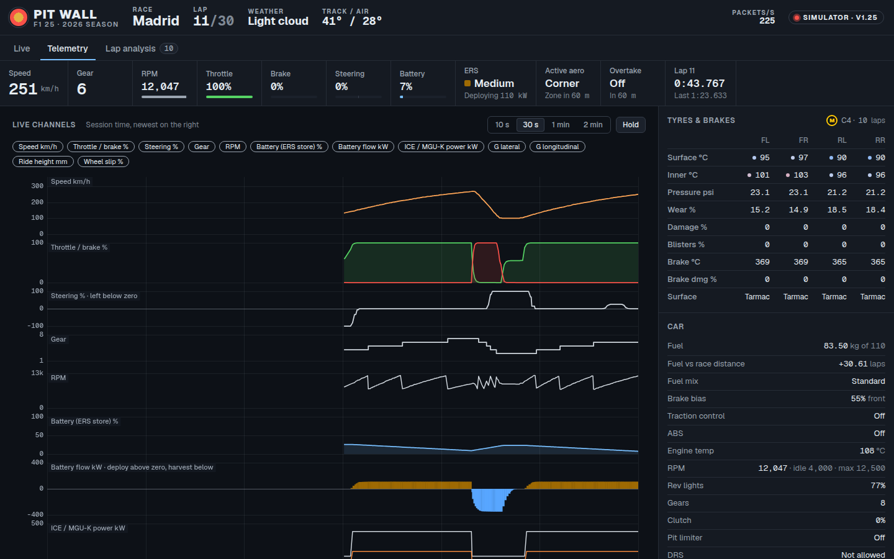
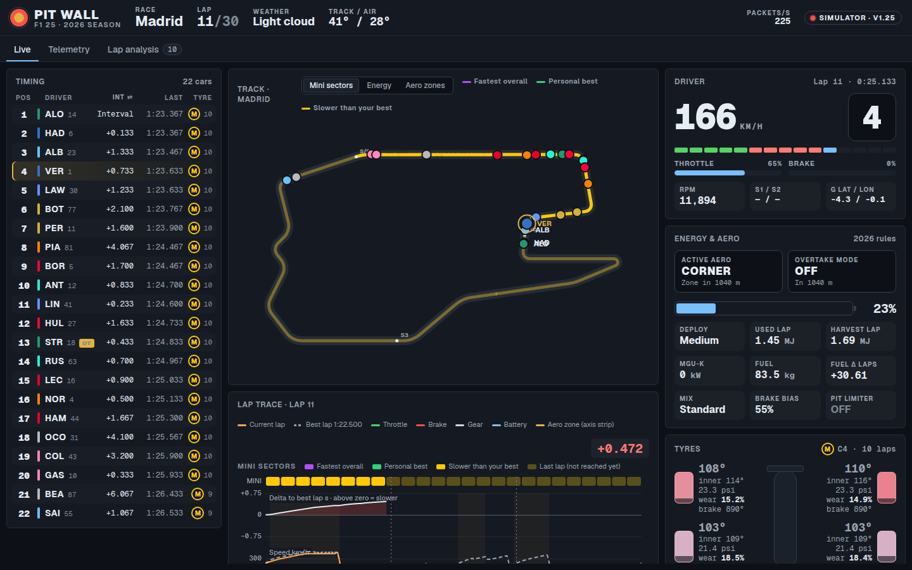
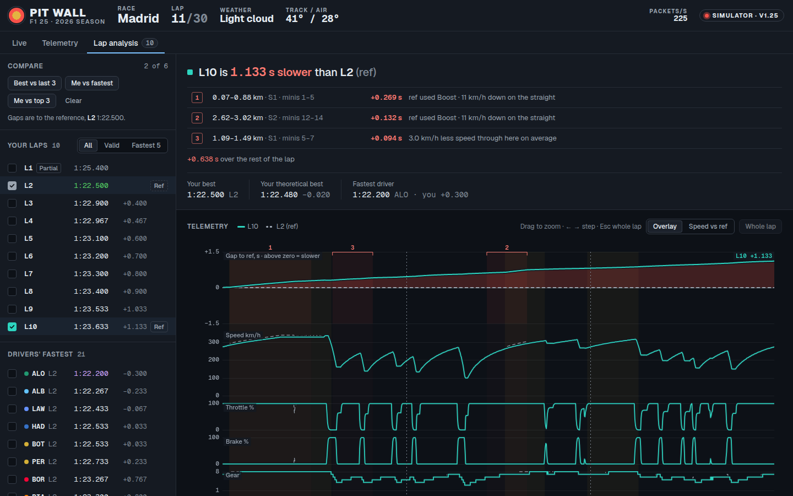

# Pit Wall — F1 25 · 2026 Season telemetry dashboard

A live pit-wall dashboard for **EA F1 25 with the 2026 Season Pack** ("F1 26"). It turns the
game's UDP telemetry into what a driver needs to get faster: where a lap loses time, how the
battery was deployed, and everything the car reports, including the new 2026 **active aero**
and **overtake mode**.

The UDP parser is written from scratch (`backend/src/PitWall.Telemetry`) for
`packetFormat 2026`; every packet layout is checked against the published byte sizes.



## What's in it

- **Live**: timing tower, track map with mini sectors and an energy map, lap trace against
  your best lap with a live delta, cockpit, energy and aero, tyres, damage and an event feed.
- **Telemetry**: your car only, every channel. Rolling traces of speed, pedals, steering,
  gear and RPM, battery, deploy/harvest flow by ERS mode, ICE and MGU-K power, G-forces, ride
  height and wheel slip. Also an energy breakdown with the per-lap harvest limit, a G-G
  diagram, per-wheel slip, loads and suspension, tyres and brakes, your tyre sets for the
  weekend, power-unit wear, race control and the car setup. Your best lap can be drawn dashed
  under the live traces, and any time window exports as CSV.
- **Lap analysis**: compare any of your laps with each other, with other drivers' fastest
  laps and with your fastest laps on the track from earlier sessions; it leads with the loss
  zones (where, how much, and why) and zooms every chart to them. Compared laps export as CSV.
- A **lap library**: every clean timed lap is kept in a SQLite file (`data/pitwall.db`), so
  the next session on the same track can be measured against your all-time best.
- A **simulator** that emits real 2026-format packets, so everything runs without the game,
  and **record / replay** of raw sessions.

| Live | Lap analysis |
|---|---|
|  |  |

## Run it

Development runs the .NET server and the Vite dev server side by side:

```bash
cd backend/src/PitWall.Server
dotnet run --launch-profile sim    # simulated 22-car race, no game needed
dotnet run --launch-profile live   # live: listens for the game on UDP 20777

cd frontend
npm install
npm run dev                        # dashboard, proxies /ws to the server on :5080
```

Open <http://localhost:5173>. Point the dev server at another backend with
`PITWALL_API=http://host:port npm run dev`.

Production is the Docker image below: the server serves the built dashboard itself.

### Docker

```bash
docker compose up -d                                          # live telemetry
docker compose run --rm --service-ports pitwall --sim         # simulator
docker compose run --rm --service-ports pitwall --record recordings/race.f1rec
```

The container runs on its own `pitwall` bridge network and publishes the dashboard on
`5173/tcp` and the telemetry port on `20777/udp`. Point the game at **your PC's LAN IP**
(not the container's IP). Change the host ports with `PITWALL_HTTP_PORT` / `PITWALL_UDP_PORT`,
e.g. `PITWALL_HTTP_PORT=8080 docker compose up -d`. Recordings land in `./recordings`, and
your lap library in `./data`.

### Game settings

In F1 25: **Settings → Telemetry Settings**

| Setting | Value |
|---|---|
| UDP Telemetry | On |
| UDP Format | **2026** (older saves default to 2025 — the dashboard warns you) |
| UDP IP Address | IP of the machine running this dashboard |
| UDP Port | 20777 |
| UDP Send Rate | 30 Hz or 60 Hz |
| Your Telemetry | Public (needed to see other cars' ERS/tyres online) |

If the game runs on another machine (PS5, Xbox, a Windows PC) open the port — on Fedora:

```bash
sudo firewall-cmd --add-port=20777/udp            # until reboot
sudo firewall-cmd --permanent --add-port=20777/udp # permanently
```

### Options

```bash
dotnet run -- --record session.f1rec   # save raw packets while driving
dotnet run -- --replay session.f1rec   # replay them later (loops)
dotnet run -- --udp-port 20778 --port 8080
dotnet run -- --data laps.db           # where the lap library lives (default data/pitwall.db)
dotnet run -- --no-save-laps           # don't keep laps from this run
dotnet run -- --sim --save-laps        # the simulator keeps none unless asked
```

The simulator never writes to the lap library by default, so its laps can't mix with
your real ones.

## Layout

```
backend/src/PitWall.Telemetry   2026 packet layouts + little-endian codec
backend/src/PitWall.Core        folds packets into a Snapshot; lap archive, mini sectors
backend/src/PitWall.Simulator   synthetic race that emits real 2026 binary packets
backend/src/PitWall.Server      UDP / sim / replay → WebSocket (30 Hz), lap library, serves the dashboard
backend/tests                   packet sizes vs the spec, round-trips, lap tracking
frontend/                       React dashboard (Vite)
```

`dotnet test` (in `backend/`) checks every packet size against the spec, round-trips fields,
runs a simulated race end to end and exercises the lap library.
`npm test` (in `frontend/`) covers the lap maths, loss zones, energy states, the telemetry
buffer and CSV export; `npm run typecheck` checks the rest.

## Known unknowns

- The 2026 format sends G-forces as int16. The scale factor isn't confirmed; it's
  `GForceScale` in `backend/src/PitWall.Telemetry/PacketFormat.cs` — adjust if the G readout looks off in-game.
- ERS percentage assumes a 4 MJ store (`ERS_MAX_J` in `frontend/src/api/types.ts`).
- Extended motion (packet 13), car setups (packet 5) and tyre sets (packet 12) follow the
  published layouts but haven't been checked against a real capture yet. Suspension travel
  and velocity are shown in the game's own units.

## License

[MIT](LICENSE)

## Disclaimer

An unofficial fan project. Not affiliated with, endorsed or sponsored by Electronic Arts,
Codemasters, Formula One or any team. F1 and related marks belong to their owners. Team names
and colours are used only to identify cars in the game's own telemetry.
